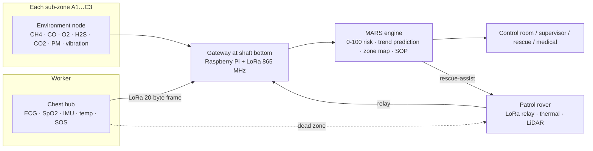
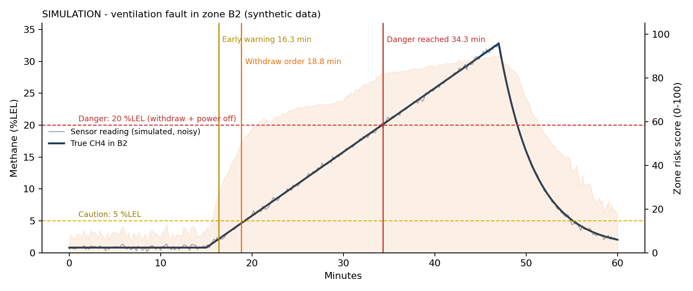
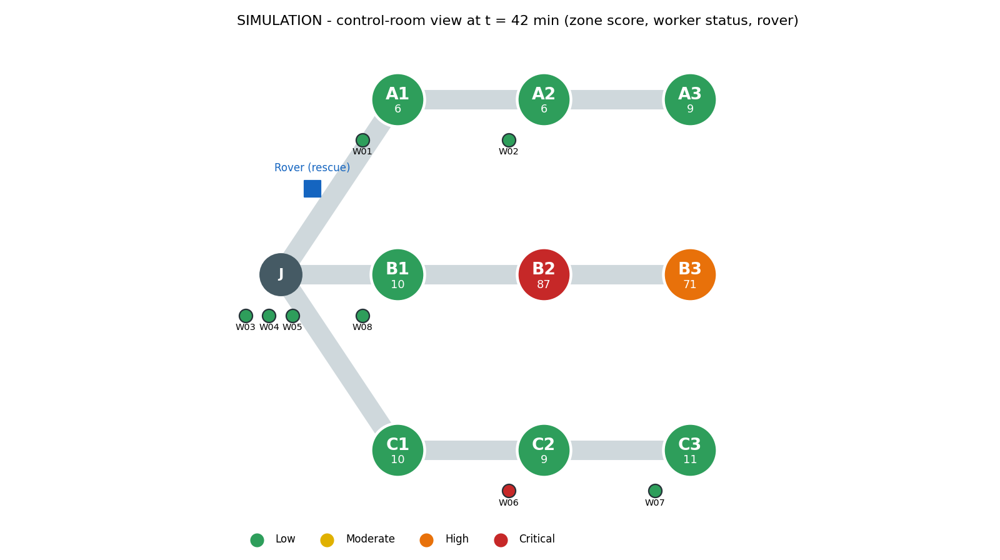

# MARS — Mining Accident and Risk Solutions

**Vishwakarma Awards 2026–27 · Application ID `VK26-IITH-SM-0078`**
Theme: Sustainable Mining · Sub-theme: Worker Health, Safety & Environmental Hazard Tracking
Team lead: Aditya Raghunath Singh, National Institute of Technology Sikkim

MARS is a mine-safety system. It combines a worker wearable, fixed gas and environment nodes, a LoRa gateway and a control-room engine. The engine scores every zone and worker from 0 to 100, predicts hazards from trends, locates the affected workers and recommends the SOP response. A patrol rover acts as a mobile radio relay and as a rescue scout.

## Status (Stage 2, October 2026): be clear about what exists

| Part | Status |
|---|---|
| Risk-scoring engine, alerting, SOP linking (`software/mars`) | **Working in simulation**; 8 unit tests pass |
| 20-byte LoRa telemetry frame with CRC-16 (`software/mars/packet.py`) | **Implemented + tested** (Python; firmware port planned) |
| 60-minute mine scenario simulator (`software/mars/sim.py`) | **Working**; all data is synthetic |
| Wearable chest-hub enclosure, rover-lite envelope (`hardware/cad`) | **CAD v0** (CadQuery → STEP/STL); packaging study only |
| Bill of materials (`hardware/bom.csv`) | **Indicative prices** (±30 %), awaiting vendor quotes |
| Wearable / node / gateway hardware | **Not built yet**; procurement is the next step |
| ESP32 firmware, ML hazard model, 3D map, dashboard app | **Planned** for Stage 3 (see roadmap) |
| Field or lab validation | **None yet** |

## Architecture



## Quick start

```bash
pip install -r requirements.txt
cd software && python -m pytest -q          # 8 tests
python scripts/run_demo.py                 # writes results/*.png, *.json
python ../hardware/cad/build_cad.py        # needs cadquery; writes STEP/STL + renders
```

## Demo scenario result (synthetic data)

A ventilation fault in zone B2 drives methane up by 1 %LEL per minute. The simulator sends every worker's data as an encoded 20-byte frame over a lossy radio model, and the engine reacts:

| Event | Simulated time |
|---|---|
| Early warning: "methane rising" in B2 (reading 1.8 %LEL) | 16.3 min |
| Withdraw order: High risk, trend-based (reading 4.7 %LEL) | 18.8 min |
| All workers out of B2/B3 | 20.8 min |
| True methane reaches the 20 %LEL danger level | 34.3 min |
| Worker W06 falls in C2; auto-SOS after 60 s with no motion | 40.0 / 41.0 min |
| Rover switches from patrol to rescue-assist and is on scene | 45.3 min |




These numbers only show that the logic behaves as designed. They depend entirely on the assumptions in `software/mars/sim.py`, such as noise levels, link probabilities and ramp rates. They are **not** evidence of real-world performance.

## Target specifications (Phase 1 prototype)

| Parameter | Target | Basis |
|---|---|---|
| Wearable battery life | ≥ 12 h (8 h shift + 50 % margin) | ~30.5 mA estimated average → ~19 h on 700 mAh (`hardware/calcs.py`); to be measured |
| Telemetry interval | 10 s; fall/SOS sent immediately with 3 retries | `software/mars/sim.py` |
| Radio | LoRa 865–867 MHz (India licence-exempt), SF7/125 kHz | 20-byte frame ≈ 57 ms airtime |
| Hazard alert latency | < 15 s from sensor to control room | to be measured |
| Wearable size / mass | 72 × 48 × 20 mm body, < 80 g | CAD v0 rev B (strap-lug bar 4.5 mm, FoS ≈ 2.2 at 100 N snag) |
| Gas channels per node | CH4 (%LEL), CO, O2, H2S, CO2, PM2.5, T/RH, vibration | `hardware/bom.csv` |
| Rover patrol | 1.94 km reference route: ~41 min/cycle at 1.0 m/s; ≤ 30 min needs ≥ 1.6 m/s or 2 rovers | `hardware/calcs.py` |
| Phase 1 BOM | ≈ ₹57k core (2 wearables, 2 nodes, gateway); ≈ ₹90k with rover-lite | `hardware/bom.csv` |

## Repository layout

```
software/mars/      thresholds, risk scoring, engine, SOPs, zones, packet, simulator
software/tests/     pytest suite
software/scripts/   run_demo.py
hardware/cad/       CadQuery source, STEP/STL, renders
hardware/bom.csv    itemised BOM with lead times
hardware/calcs.py   strap-lug stress, battery life, LoRa airtime, rover patrol cycle
results/            generated figures and logs
```

## Important caveats

- **Thresholds** in `software/mars/thresholds.py` come from published limits (OSHA, NIOSH, ACGIH, USACE EM 385-1-1) or are marked *indicative*. They have not yet been checked against the Coal Mines Regulations, 2017 or DGMS circulars.
- **SOPs** in `software/mars/sop.py` are illustrative. A real deployment uses the mine's approved SOPs, and the competent mine official makes the decision.
- **Not intrinsically safe.** Electronics used in gassy mines need Ex "i" certification (IEC 60079-11). The prototype is for lab and simulated-gallery testing only.
- **AI assistance:** code scaffolding and documentation in this repository were drafted with an AI coding assistant (Claude) and reviewed by the team. Commits carry a `Co-Authored-By` trailer.

## Roadmap to Stage 3 (Nov 2026 – Jan 2027)

1. Order parts; bring up the wearable (ECG, SpO2, IMU, temp) and run bench comparisons against a reference pulse oximeter.
2. Port the frame format and fall/inactivity logic to ESP32 firmware; run a LoRa range test in a corridor or basement.
3. Build the environment node; calibrate it against a certified multi-gas detector.
4. Build the web dashboard on top of `mars.engine`; record the 3-minute Stage 3 demo video.
5. Stretch goal: rover-lite patrol and relay.

License: MIT
